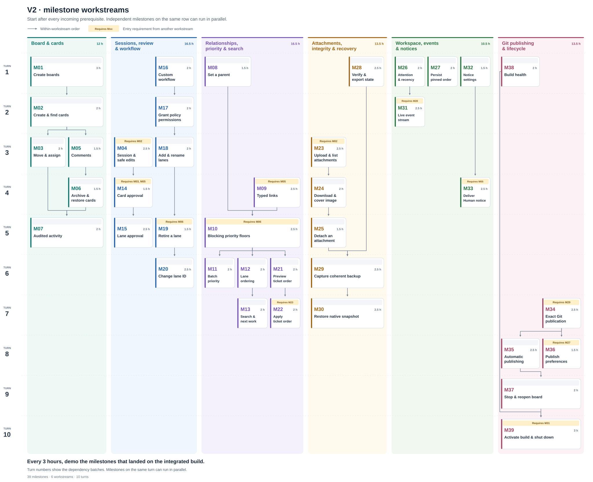

# Localswim V2 milestone plan

[Reviewed staffing and execution roster](execution-plan.md)

Build a fresh Go backend. One loopback listener serves every board and the workspace. The browser and CLI share the REST API. Keep V2 data and its port separate from V1. New projects start in V2. V1 data migration and legacy schema conversion are outside this plan.

## Three-day delivery target

**First-day target.** Open a working board in the browser. Demonstrate creating and switching boards, adding, editing, and moving a card, and reopening after restart with the changes intact. The browser and CLI start with shared API examples and then connect to the real service.

**Three-day target.** Integrate and demo V1 parity on Windows. Update the release forecast as the demos land. Browser and CLI work, integration, review, and demo time are separate from the backend estimates below.

The 82.5 hours are aggregate backend development, not a serial schedule. With six backend owners the largest stream is 16.5 hours before cross-stream waits and integration. The browser and CLI have separate owners and start on day one.

Each milestone appears on the first turn after all its prerequisites. Solid arrows show order within a workstream. A label in the reserved space at the top of each card lists its entry requirements from other workstreams. **Parallel** marks milestones on the same turn that can use separate owners. Each row is a turn batch whose milestones can run in parallel.

| Turn ↓ | Board and card API 12 h | Sessions, review, and workflow 16.5 h | Relationships, priority, and search 16.5 h | Attachments, integrity, and recovery 13.5 h | Workspace, events, and notices 10.5 h | Git publishing and lifecycle 13.5 h |
| --- | --- | --- | --- | --- | --- | --- |
| Turn 1 | M01 | M16 | M08 | M28 | **Parallel** M26 M27 M32 | M38 |
| Turn 2 | M02 | M17 | — | — | M31 | — |
| Turn 3 | **Parallel** M03 M05 | **Parallel** M04 M18 | — | M23 | — | — |
| Turn 4 | M06 | M14 | M09 | M24 | M33 | — |
| Turn 5 | M07 | **Parallel** M15 M19 | M10 | M25 | — | — |
| Turn 6 | — | M20 | **Parallel** M11 M12 M21 | M29 | — | — |
| Turn 7 | — | — | **Parallel** M13 M22 | M30 | — | M34 |
| Turn 8 | — | — | — | — | — | **Parallel** M35 M36 |
| Turn 9 | — | — | — | — | — | M37 |
| Turn 10 | — | — | — | — | — | M39 |

The browser and CLI start beside these streams with the shared API examples. The first browser demo uses the live M01–M04 service.

The listed milestone prerequisites supply the arrows and turn batches. Turn 1 contains M01, M16, M08, M28, M26, M27, M32, and M38. Later turns follow their dependencies. Agree the shared contracts before Turn 1.

Agree on board and card IDs, actor context, revision checks, and one mutation transaction before work fans out. Give one integration owner the shared schema and routes. Other owners work in separate feature files. Use small fixtures for focused tests once the milestone prerequisites are in place. Each milestone gets its own live API demo once its prerequisites are available. Move its card to Ready for Review when implementation, required checks, and independent review finish. Track a deferred walkthrough as Demo pending.

Demo at least once every three hours of build time. At the end of a turn, demo any milestones in Ready for Review that can demo, even if less than three hours have elapsed. Work advances as its prerequisites are ready. Each break gets its lineup from all milestones that landed on the integrated build during that block. Show each one using its demo below. A deferred demo goes into the first break after its prerequisites are ready.

## API demos

The routes are proposed contracts. `B` means `/api/2026-11-10/boards/{board_id}` and `C` means `/api/2026-11-10/cards/{card_id}`. Collection requests carry board/card IDs as filters or body fields. The exact wire contract is [OpenAPI](docs/openapi.yaml). Its output schemas are canonical, while accepted UUID input is case-insensitive. Estimates include coding and focused tests. Demo time is separate. Aim for 2 hours and cap development at 3 hours per milestone. M01–M03 take an estimated 7 development hours on the backend path.

| Milestone | Dev estimate | Prerequisites | What the API demo shows |
| --- | ---: | --- | --- |
| M01 | 3 h | — | **Create a workspace and boards.** On one loopback port, `POST /api/2026-11-10/boards` twice with the built-in workflow. `GET /api/2026-11-10/boards` lists both. Restart and fetch each by ID to show durable, isolated state. A competing writer refuses the same data root. |
| M02 | 2 h | M01 | **Create and find cards.** `POST /api/2026-11-10/cards` allocates a ticket and default priority. Read it by stable ID and ticket. Reject a duplicate explicit ID or stale board revision without allocating another ticket. |
| M03 | 2 h | M02 | **Move and assign cards.** `PATCH C` moves a card along an allowed transition and assigns an owner in a separate edit. Read the saved lane and attribution. A disallowed Human or Bot action leaves the revision unchanged. |
| M04 | 2.5 h | M02 | **Browser session and conflict-safe edits.** `GET B/session` gives the same-origin browser its Human context and board styling. `PATCH C` edits the title and description. Show a stale card conflict, an unrelated edit that leaves the card token valid, and readback after a lost reply. |
| M05 | 1.5 h | M02 | **Comment and read newest comments.** `POST /api/2026-11-10/comments` records text, actor, and time. `GET /api/2026-11-10/comments?board_id={board_id}&limit=2` returns the newest attributed comments across cards. |
| M06 | 1.5 h | M05 | **Archive and restore cards.** `PATCH C` with `archived: true` hides the card from ordinary lists. A focused read still shows its history. Unarchive and confirm the same ID, ticket, and lane. |
| M07 | 2 h | M03, M06 | **Read audited activity.** `GET /api/2026-11-10/activities?board_id={board_id}` with a UTC interval returns attributed changes. Its monitor view returns bounded actor, time, ticket, and operation metadata without card prose. Reject malformed bounds. |
| M08 | 1.5 h | — | **Set a parent.** `PATCH C` sets or clears a parent. Focused reads show the corresponding child list and audit. A parent cycle is refused. |
| M09 | 2.5 h | M05 | **Manage typed links.** `POST /api/2026-11-10/cards` creates a card with valid related-card links in one write. Replace a link type through `/api/2026-11-10/relationships` and show both directions on readback. An invalid target rolls back creation. Show Human `#ticket` references linked from a comment and Bot text left unchanged. |
| M10 | 2.5 h | M06, M08, M09 | **Apply blocking priority floors.** Create a `blocks` relationship through `/api/2026-11-10/relationships` and show audited transitive promotions in one revision. Demonstrate a demotion floor, an archived unfinished blocker, a Completed cutoff, and no automatic demotion after unlinking. |
| M11 | 2 h | M10 | **Change priorities as a batch.** `PATCH /api/2026-11-10/cards` evaluates selected priorities together and returns effective priorities plus cascades. A duplicate reference or Completed selection refuses the whole batch. |
| M12 | 2 h | M10 | **Order visible swimlanes.** `GET B?view=lanes` shows priority first, then same-rank blockers before blocked cards. Show a cycle in ticket order and exclude archived cards from the visible graph. |
| M13 | 2 h | M12 | **Search and find next work.** `GET /api/2026-11-10/cards?board_id={board_id}&sort=triage&lane_id={lane_id}&limit=2` applies the V1 whole-board triage score before filtering. Add a search term to match title or ticket, and demonstrate explicit content search and numeric order for relationship lookup. |
| M14 | 1.5 h | M03, M04, M05 | **Approve one review.** Human `POST /api/2026-11-10/approvals` adds the review comment and moves the card to Completed in one revision. Bot and stale requests cannot approve or duplicate the comment. |
| M15 | 2.5 h | M14 | **Approve a review lane.** Enable the optional action on Ready for Review. `POST /api/2026-11-10/approvals` approves the exact rendered set under board and card versions. A changed membership refuses the entire action. |
| M16 | 2 h | — | **Create a custom workflow.** `POST /api/2026-11-10/boards` accepts named lanes, users, priorities, and transition rules. Read the resolved stable IDs. A project rename keeps the board address. An invalid workflow refuses creation. |
| M17 | 2 h | M16 | **Grant policy permissions.** `PUT /api/2026-11-10/policies/{policy_id}` adds validated creation and transition grants atomically. Exercise the newly authorized move. Refuse an invalid grant set and a browser attempt at CLI-only maintenance. |
| M18 | 2 h | M17 | **Add and rename lanes.** `POST /api/2026-11-10/lanes` inserts a lane beside a stable anchor with explicit rights. `PATCH /api/2026-11-10/lanes/{lane_id}` changes the label while preserving the ID, cards, and grants. |
| M19 | 1.5 h | M06, M18 | **Retire a lane.** Retire an empty active lane through `PATCH /api/2026-11-10/lanes/{lane_id}`. Archived cards and history remain inspectable. Active occupancy, Completed, and in-place unarchive are refused. |
| M20 | 2.5 h | M19 | **Change a lane key.** `PATCH /api/2026-11-10/lanes/{lane_id}` changes the board-local key and audits it while the lane UUID and all references remain fixed. The completed role/key stays protected. |
| M21 | 2 h | M10 | **Preview dependency ticket order.** `GET /api/2026-11-10/ticket-orders/{lane_id}?preview=true` previews a selected ticket pool using full blocker paths. The revision stays unchanged. A selected cycle refuses. |
| M22 | 2 h | M21, M23 | **Apply dependency ticket order.** `PUT /api/2026-11-10/ticket-orders/{lane_id}` applies a current preview. Read back the new ticket numbers, unchanged card IDs and attachment anchors, and the renumber audit. A stale preview refuses. |
| M23 | 2.5 h | M02 | **Upload and list attachments.** Create a card, then `POST /api/2026-11-10/attachments` for a valid file and a file over 10 MiB. List the successful file with original name and attribution. Readback resolves an uncertain upload without blindly repeating it. |
| M24 | 2 h | M23 | **Download, preview, and select a cover.** `GET /api/2026-11-10/attachments/{attachment_id}/content` returns verified bytes. Show raster preview and safe generic download. Select an active raster as the cover through `PATCH C` and read it back. |
| M25 | 1.5 h | M24 | **Detach an attachment.** `DELETE /api/2026-11-10/attachments/{attachment_id}` removes active access and clears its selected cover. Focused history still records the attachment for backup. |
| M26 | 2 h | — | **Show workspace attention and recency.** `GET /api/2026-11-10/boards` shows the three attention counts and exact latest audited card edit. Compare archived edits, a project rename, and an unavailable board to show the correct ordering and distinction between unknown and zero. |
| M27 | 2 h | — | **Persist pinned board order.** `PATCH /api/2026-11-10/workspace` saves manual pin order under a separate revision. Another client and a restart read the same order. Stale saves and invalid stored preferences produce visible failures. |
| M28 | 2.5 h | — | **Verify and export native board state.** `GET /api/2026-11-10/verifications/{board_id}` and `GET /api/2026-11-10/snapshots/{board_id}` verify and export board policy, cards, and audit. Compare a valid snapshot with a damaged one. Status reports failed durable state separately from the last accepted view. The CLI can run the same validator offline. |
| M29 | 2.5 h | M25, M28 | **Capture a coherent backup.** `POST /api/2026-11-10/backups` captures one revision plus the exact verified attachment bytes, including detached files. Download the backup. A concurrent edit stays live and appears in the next capture. |
| M30 | 2.5 h | M29 | **Restore or admit a native snapshot.** `PUT /api/2026-11-10/snapshots/{board_id}` refuses a damaged V2 backup. Apply the valid backup to recover the existing board at the same address with a higher revision. Read back the recovered card and attachment bytes. |
| M31 | 2.5 h | M26, M28 | **Stream live board and workspace changes.** `GET /api/2026-11-10/events?board_id=a&watch=b` streams current catalog, selected-board, and retained-board versions after committed edits. Reconnect gets current state. An unchanged board can return `304`. Disconnect releases the subscription. |
| M32 | 1.5 h | — | **Configure owner notices.** `GET` and `PATCH B` show the private target and off-by-default state. Retargeting preserves enablement. Enable and disable persist across restart. |
| M33 | 2.5 h | M05, M32 | **Deliver a committed Human notice.** Make Human and Bot edits with notices enabled. Observe one bounded metadata-only notice after the quiet interval through the native queue command and an approved test destination. A delivery failure does not undo a saved edit. |
| M34 | 2.5 h | M29 | **Publish an exact Git backup.** `POST /api/2026-11-10/publications` publishes a captured backup to a disposable Git remote. Verify the committed paths match the capture and unrelated staged work survives. Refuse unsupported hooks, filters, or filesystem monitors before staging. |
| M35 | 2.5 h | M34 | **Publish automatically and recover a failed push.** Enable board publishing through `PATCH B`. A committed edit publishes after quiet. Show a failed push in status, then recovery of the pending push without another card edit. |
| M36 | 1.5 h | M27, M34 | **Publish workspace preferences independently.** Enable workspace publishing through `PATCH /api/2026-11-10/workspace` and save pin order. The test remote receives just the preferences artifact. Show that board and workspace publishing use the same repository lock. |
| M37 | 2 h | M35 | **Stop and reopen one board.** `PATCH B` closes and flushes the selected board. Another board continues serving on the same port. Reopen the selected board at its existing address and read the saved revision. |
| M38 | 2 h | — | **Report build health before activation.** `GET /api/2026-11-10/service` reports the running build and a staged replacement's validation status. Stage an invalid candidate and show its refusal while the running service continues serving valid data. |
| M39 | 3 h | M31, M37, M38 | **Activate a build and stop cleanly.** `POST /api/2026-11-10/activations` applies a valid staged build. Reconnect to the same port and board URLs with fresh credentials. An authorized shutdown drains admitted writes and streams and flushes enabled publishing. A failed final push refuses shutdown and is reported in status. |

Before M01, confirm the Go toolchain, an available loopback port, and a local store that can commit atomically and reject a competing writer. Start with one built-in workflow and local credentials. From the first write, check actor authority and the applicable revision before committing data and audit together. Show refusals and uncertain outcomes without replaying writes.

Keep the cap by splitting at a useful HTTP result. If setup runs long, demo reading one newly initialized durable board before adding API creation. If upload verification, retained-board streaming, Git publishing, or Windows handoff runs long, split at upload versus readback, selected versus retained boards, commit versus push, or graceful shutdown versus process activation. Use disposable Git repositories and an approved test destination for the notification demo.

Native snapshot admission is an explicit V2 operation. Before calling parity complete, check any operator workflow that depends on V1 detecting an external file replacement or applying a source update automatically. The corresponding demos cover the recovery and same-port replacement behavior. Browser layout, accessibility, drafts, navigation, and CLI presentation still need side-by-side checks against V1 using this API.

[V1 behavior reference](https://github.com/TerryOtt/localswim/blob/46d5d58695aa807c246c42e45f0615860fdcbbe5/README.md)
